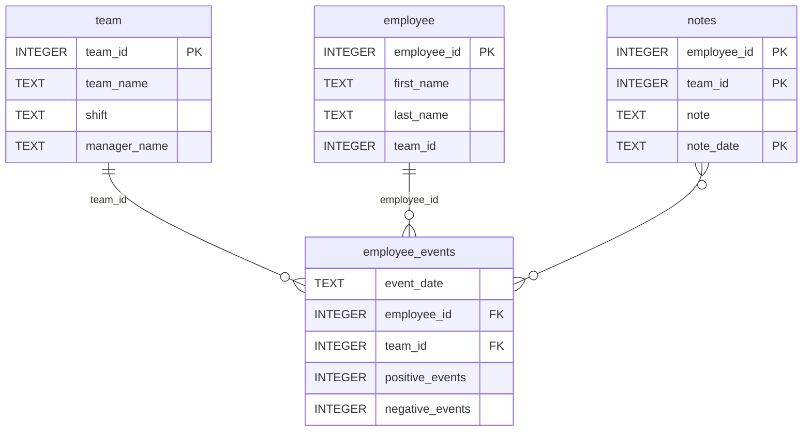

# Employee Performance and Recruitment Risk Dashboard

This repository holds my final project for the **Software Engineering for Data Scientists** course of the Udacity Data Scientist Nanodegree.

A manufacturing company wants to keep its best employees. Managers record positive and negative performance events for each employee, and a machine learning model uses those events to predict how likely an employee is to be recruited by another company. This project delivers two things:

1. **`employee_events`**, an installable Python package that runs the SQL queries against the company's SQLite database, so other teams can get the data without writing SQL.
2. **A FastHTML dashboard** that lets a manager pick an employee or a team and see their performance over time, their predicted recruitment risk, and the notes written about them.

## What the dashboard shows

* A title that reads "Employee Performance" or "Team Performance", depending on the filter.
* A filter to switch between employees and teams and to pick one of them.
* A line chart of cumulative positive and negative events.
* A bar chart of the predicted recruitment risk. For a team it shows the average risk of its members. The bar is colored on a green to red scale, so a higher risk is easier to spot.
* A table of the manager notes.

## Set up the environment

The project works with Python 3.10 to 3.13. It was built with Python 3.11, and the GitHub Actions use Python 3.10. All commands are run from the root of the repository.

```bash
# 1. Create and activate a virtual environment
python -m venv venv
source venv/bin/activate        # on Windows: venv\Scripts\activate

# 2. Build the employee_events package
#    (setuptools is not included in new environments from Python 3.12 on)
python -m pip install --upgrade pip setuptools
cd python-package
python setup.py sdist
cd ..

# 3. Install the dependencies and the package
pip install -r requirements.txt
```

`requirements.txt` pins the versions the dashboard was built and tested with, and its last line installs the `employee_events` package from `python-package/dist/`.

While developing the package you can install it in editable mode instead:

```bash
cd python-package
pip install -e .
```

## Run the dashboard

```bash
python report/dashboard.py
```

Then open <http://localhost:5001> in a browser. The page for a single employee or team is also available directly, for example `/employee/2` or `/team/2`.

## Run the tests

```bash
pytest
```

The tests check that the database file exists and that it contains the `employee`, `team` and `employee_events` tables.

Two GitHub Actions run on every push and pull request to the `main` branch:

* **Tests** builds the package, installs the dependencies and runs `pytest`.
* **Lint** checks the code style with `flake8`, using the settings in `.flake8`.

## How the code is organized

* `QueryMixin` (in `sql_execution.py`) opens the database connection, runs a query, closes the connection and returns the data, either as a pandas dataframe or as a list of tuples.
* `QueryBase` inherits from `QueryMixin` and holds the queries that work for both employees and teams.
* `Employee` and `Team` inherit from `QueryBase` and add the queries that are specific to each.
* The dashboard classes in `report/dashboard.py` inherit from the pre-built components in `report/base_components` and `report/combined_components`.

### Repository Structure
```
├── README.md
├── .flake8
├── .github
│   └── workflows
│       ├── lint.yml
│       └── test.yml
├── assets
│   ├── model.pkl
│   └── report.css
├── python-package
│   ├── dist
│   │   └── employee_events-0.0.tar.gz
│   ├── employee_events
│   │   ├── __init__.py
│   │   ├── employee.py
│   │   ├── employee_events.db
│   │   ├── query_base.py
│   │   ├── requirements.txt
│   │   ├── sql_execution.py
│   │   └── team.py
│   └── setup.py
├── report
│   ├── base_components
│   │   ├── __init__.py
│   │   ├── base_component.py
│   │   ├── data_table.py
│   │   ├── dropdown.py
│   │   ├── matplotlib_viz.py
│   │   └── radio.py
│   ├── combined_components
│   │   ├── __init__.py
│   │   ├── combined_component.py
│   │   └── form_group.py
│   ├── dashboard.py
│   └── utils.py
├── requirements.txt
├── src
│   └── (scripts supplied with the starter code that generated the database and the model)
└── tests
    └── test_employee_events.py
```

### employee_events.db



## Acknowledgements

The starter code, the database, the trained model and the component library come from the [Udacity starter repository](https://github.com/udacity/dsnd-dashboard-project). The dashboard is built with [FastHTML](https://docs.fastht.ml/).
